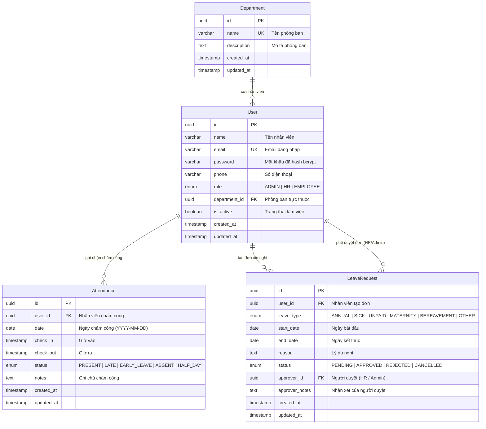

# Hệ Thống Quản Lý Nhân Sự (HRMS Backend)

Dự án Backend quản lý nhân sự chuyên nghiệp xây dựng trên nền tảng **Node.js, Express, PostgreSQL (Supabase)** và **Prisma ORM**.

---

## 1. Cấu trúc Thư mục Chuẩn (Standard Folder Structure)

```text
hrms-backend/
├── .env                        # Biến môi trường & Connection string (Supabase)
├── .env.example                # File mẫu biến môi trường
├── package.json                # Dependencies: express, @prisma/client, bcrypt, jsonwebtoken, zod, cors
├── README.md                   # Tài liệu hướng dẫn sử dụng
├── schema.sql                  # File DDL SQL PostgreSQL thuần
├── prisma/
│   ├── schema.prisma           # Prisma Data Model, Enums & Relations
│   └── seed.js                 # Script nạp dữ liệu mẫu (Admin, HR, Employee)
└── src/
    ├── config/
    │   └── db.js               # Khởi tạo singleton PrismaClient
    ├── controllers/            # Tầng xử lý logic nghiệp vụ
    │   ├── auth.controller.js      # Controller: Đăng nhập (login) & lấy thông tin cá nhân (getMe)
    │   ├── employee.controller.js  # Controller: Quản lý nhân viên (CRUD, Pagination, Join Dept)
    │   └── user.controller.js      # Controller: Quản trị User
    ├── middlewares/            # Tầng Middleware xử lý trung gian
    │   ├── auth.middleware.js  # Xác thực JWT Token (Bearer token header)
    │   ├── role.middleware.js  # Phân quyền truy cập theo vai trò (Admin, HR, Employee)
    │   └── error.middleware.js # Bắt và chuẩn hóa lỗi hệ thống (Global Error Handler)
    ├── routes/                 # Tầng định tuyến API (Routing)
    │   ├── auth.routes.js      # Routes cho /api/auth (Login, Me)
    │   ├── employee.routes.js  # Routes cho /api/employees (CRUD nhân viên)
    │   ├── user.routes.js      # Routes cho /api/users
    │   └── index.js            # Gom và gắn tiền tố cho tất cả routes
    ├── utils/                  # Tiện ích dùng chung
    │   ├── jwt.js              # Ký và xác minh JWT Token
    │   └── response.js         # Chuẩn hóa format phản hồi JSON
    ├── validators/             # Tầng kiểm tra tính hợp lệ dữ liệu (Validation)
    │   └── employee.validator.js # Zod schemas validate thêm mới & cập nhật nhân viên
    ├── app.js                  # Cấu hình Express App, CORS, Middlewares
    └── index.js                # Khởi động Server Express & kiểm tra kết nối DB
```

---

## 2. Sơ đồ Quan hệ Thực thể (ERD Diagram)



---

## 3. Tài khoản Thử nghiệm Mẫu (Đã Seed sẵn)

| Vai trò (Role) | Họ và Tên | Email | Mật khẩu | Quyền hạn truy cập |
|---|---|---|---|---|
| **ADMIN** | Nguyễn Văn Quản Trị | `admin@hrms.local` | `Admin@123` | Toàn quyền xem & tạo nhân viên, duyệt phép, quản trị |
| **HR** | Trần Thị Thu Thảo | `hr@hrms.local` | `Hr@123` | Quản lý nhân viên, duyệt đơn nghỉ phép, xem chấm công |
| **EMPLOYEE** | Lê Hoàng Nam | `nam.le@hrms.local` | `Emp@123` | Nhân viên (bị chặn truy cập các API yêu cầu Admin/HR) |

---

## 4. API Xác thực (Authentication)

- `POST /api/auth/login`: Đăng nhập bằng `email` & `password`. Trả về JWT Token.
- `GET /api/auth/me`: Lấy thông tin tài khoản hiện tại (Header `Authorization: Bearer <token>`).

---

## 5. API Quản Lý Nhân Viên (RESTful Employees API)

### 5.1. `GET /api/employees` - Lấy danh sách nhân viên có phân trang & Join Departments
- **Quyền hạn**: Đã đăng nhập (`authMiddleware`).
- **Query Params**:
  - `page`: Trang hiện tại (mặc định: `1`).
  - `limit`: Số bản ghi mỗi trang (mặc định: `10`, tối đa `100`).
  - `search`: Tìm kiếm theo tên hoặc email (không phân biệt hoa/thường).
  - `departmentId`: Lọc theo ID phòng ban.
  - `role`: Lọc theo vai trò (`ADMIN`, `HR`, `EMPLOYEE`).
  - `isActive`: Lọc theo trạng thái làm việc (`true` / `false`).
- **Response**:
```json
{
  "success": true,
  "message": "Lấy danh sách nhân viên thành công.",
  "data": {
    "employees": [
      {
        "id": "673e4ddc-e0e8-46ee-91cd-183eaac5f242",
        "name": "Lê Hoàng Nam",
        "email": "nam.le@hrms.local",
        "phone": "0987654321",
        "role": "EMPLOYEE",
        "isActive": true,
        "department": {
          "id": "6170f1a3-9967-415e-be47-27b5eb216753",
          "name": "Phòng Kỹ thuật & Công nghệ",
          "description": "Phát triển và bảo trì hệ thống phần mềm."
        }
      }
    ],
    "pagination": {
      "total": 3,
      "page": 1,
      "limit": 10,
      "totalPages": 1,
      "hasNextPage": false,
      "hasPrevPage": false
    }
  }
}
```

---

### 5.2. `POST /api/employees` - Thêm nhân viên mới
- **Quyền hạn**: Chỉ dành cho **Admin** hoặc **HR** (`roleMiddleware('ADMIN', 'HR')`).
- **Đặc điểm**: Tự động băm mật khẩu mặc định (`Employee@123`) nếu không truyền trường `password`.
- **Validation**:
  - `name`: Tối thiểu 2 ký tự, tối đa 100 ký tự.
  - `email`: Bắt buộc, đúng định dạng email, không được trùng lặp.
  - `phone`: Đúng định dạng số điện thoại (VD: `0901234567`).
  - `role`: Phải là một trong `['ADMIN', 'HR', 'EMPLOYEE']`.
  - `departmentId`: Phải là UUID và tồn tại trong bảng `departments`.
- **Request Body**:
```json
{
  "name": "Nguyễn Hoàng Long",
  "email": "long.nguyen@hrms.local",
  "phone": "0934567890",
  "role": "EMPLOYEE",
  "departmentId": "6170f1a3-9967-415e-be47-27b5eb216753"
}
```
- **Response (201 Created)**:
```json
{
  "success": true,
  "message": "Thêm mới nhân viên thành công! Mật khẩu mặc định: 'Employee@123'.",
  "data": {
    "id": "...",
    "name": "Nguyễn Hoàng Long",
    "email": "long.nguyen@hrms.local",
    "phone": "0934567890",
    "role": "EMPLOYEE",
    "isActive": true,
    "department": {
      "id": "6170f1a3-9967-415e-be47-27b5eb216753",
      "name": "Phòng Kỹ thuật & Công nghệ"
    }
  }
}
```

---

### 5.3. `GET /api/employees/:id` - Xem chi tiết 1 nhân viên
- **Quyền hạn**: Đã đăng nhập.
- **Tính năng**: Kiểm tra UUID hợp lệ, trả về đầy đủ thông tin phòng ban kèm số lượng bản ghi chấm công và đơn xin nghỉ phép. Trả về `404 Not Found` nếu ID không tồn tại.

---

### 5.4. `PUT /api/employees/:id` - Cập nhật thông tin nhân viên
- **Quyền hạn**: Chỉ dành cho **Admin** hoặc **HR**.
- **Tính năng**: Kiểm tra validation Zod, kiểm tra trùng lặp email với người khác (trả về `409 Conflict`), kiểm tra tồn tại phòng ban mới, trả về `404 Not Found` nếu không tìm thấy nhân viên.
- **Request Body mẫu**:
```json
{
  "name": "Nguyễn Hoàng Long (Senior)",
  "phone": "0988776655",
  "role": "HR"
}
```

---

### 5.5. `DELETE /api/employees/:id` - Vô hiệu hóa tài khoản nhân viên
- **Quyền hạn**: Chỉ dành cho **Admin**.
- **Tính năng**: Thực hiện vô hiệu hóa mềm (`isActive = false`) để bảo toàn dữ liệu lịch sử chấm công và nghỉ phép.

---

---

## 6. API Quản Lý Nghỉ Phép (Leave Management)

### 6.1. `POST /api/leaves` - Nhân viên tạo đơn xin nghỉ
- **Quyền hạn**: Đã đăng nhập (`authMiddleware`). Tự động trích xuất `userId` từ JWT token.
- **Trạng thái**: Mặc định là `Pending` (`PENDING`).
- **Validation**:
  - `startDate`, `endDate`: Bắt buộc, định dạng `YYYY-MM-DD`. `endDate >= startDate`.
  - `leaveType`: Thuộc `['ANNUAL', 'SICK', 'UNPAID', 'MATERNITY', 'BEREAVEMENT', 'OTHER']` (mặc định: `ANNUAL`).
  - **Chống trùng lặp**: Tự động chặn nếu nhân viên đã có đơn khác trùng ngày đang chờ duyệt hoặc đã duyệt (`409 Conflict`).
- **Request Body mẫu**:
```json
{
  "leaveType": "ANNUAL",
  "startDate": "2026-10-20",
  "endDate": "2026-10-22",
  "reason": "Nghỉ phép giải quyết việc gia đình"
}
```

---

### 6.2. `GET /api/leaves/my-leaves` - Nhân viên xem lịch sử xin nghỉ của mình
- **Quyền hạn**: Đã đăng nhập. Chỉ xem các đơn do chính tài khoản đó tạo.
- **Hỗ trợ**: Phân trang (`page`, `limit`), lọc theo `status`, kèm thông tin người phê duyệt (`approver`).

---

### 6.3. `GET /api/leaves` - HR / Quản lý xem toàn bộ đơn xin nghỉ
- **Quyền hạn**: **CHỈ** dành cho **Admin** hoặc **HR** (`roleMiddleware('ADMIN', 'HR')`). Nhân viên bình thường gọi sẽ nhận mã lỗi `403 Forbidden`.
- **Hỗ trợ**: Phân trang, lọc theo `status`, `leaveType`, `departmentId`, tìm kiếm theo tên/email nhân viên.
- **Join**: Kèm đầy đủ thông tin nhân viên nộp đơn (Tên, Email, Phòng ban) và người duyệt đơn.

---

### 6.4. `PUT /api/leaves/:id/status` - HR / Quản lý duyệt hoặc từ chối đơn
- **Quyền hạn**: **CHỈ** dành cho **Admin** hoặc **HR** (`roleMiddleware('ADMIN', 'HR')`).
- **Tự động ghi nhận**: Tự động gán `approverId = req.user.id` (ID của Admin/HR đang duyệt đơn).
- **Request Body mẫu**:
```json
{
  "status": "Approved",
  "approverNotes": "Đồng ý phê duyệt ngày nghỉ."
}
```
*(Chấp nhận giá trị `Approved`, `APPROVED`, `Rejected`, hoặc `REJECTED`)*

---

## 7. Hướng dẫn Khởi chạy & Sử dụng

```bash
# 1. Khởi động server
npm start

# 2. Đồng bộ Schema lên Supabase Database (khi có thay đổi mô hình)
npm run prisma:push

# 3. Nạp lại dữ liệu mẫu
npm run prisma:seed

# 4. Mở giao diện Prisma Studio
npm run prisma:studio
```
